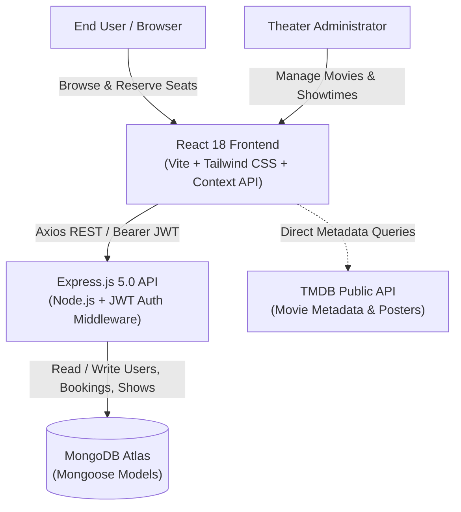

# 🎬 CineSnap Pro — Full-Stack Movie Ticket Booking Platform

[](https://react.dev/)
[](https://vitejs.dev/)
[](https://nodejs.org/)
[](https://expressjs.com/)
[](https://www.mongodb.com/)
[](https://render.com)

CineSnap Pro is a full-stack MERN movie ticket booking web application inspired by BookMyShow and Netflix. The platform delivers an end-to-end cinema reservation workflow: browsing live movies via TMDB, inspecting showtimes, selecting seats via an interactive real-time seat matrix, booking confirmation with QR-code digital passes, and an administrative dashboard for catalog management.

---

## 🏗️ System Architecture



---

## 🚀 Implemented Features

### 👤 Customer Experience
- **Catalog & Discovery:** Netflix-style hero banner and categorized movie rows powered by TMDB metadata.
- **Showtimes & Details:** Real-time synopsis, cast, runtime, release date, and theatre showtime schedules.
- **Interactive Seat Matrix:** Grid-based seat selection layout with visual status indicators (`Available`, `Selected`, `Booked`).
- **QR Digital Tickets:** Instant reservation confirmation with downloadable and printable digital tickets embedded with verification QR codes.
- **Ticket History:** Dedicated **My Tickets** dashboard showing active and past reservations.
- **Session Persistence:** JWT authentication with secure localStorage state management.

### 🔐 Administrative Management
- **Role-Based Protection:** Admin-only protected navigation guards and backend middleware.
- **Catalog Management:** Add, import, and delete cinema titles with automatic showtime generation.
- **Booking Overview:** Track reservation metrics across active movie listings.

---

## 🛠️ Technology Stack

| Layer | Technologies |
| :--- | :--- |
| **Frontend** | React 18, Vite, React Router DOM, Axios, Context API (`AuthContext`), Vanilla CSS |
| **Backend** | Node.js, Express.js 5, Mongoose, JWT (`jsonwebtoken`), `bcryptjs`, CORS, Dotenv |
| **Database** | MongoDB Atlas (Cloud NoSQL) |
| **External APIs**| The Movie Database (TMDB) API |
| **Deployment** | Render Blueprint (`render.yaml`) & Netlify (`netlify.toml`) |

---

## 📂 Project Structure

```
cinesnap-pro/
├── client/                     # React frontend (Vite)
│   ├── src/
│   │   ├── api/                # Axios instance & TMDB API clients
│   │   ├── components/         # Seat matrix, Navbar, Footer, MovieCards
│   │   ├── context/            # AuthContext provider & hooks
│   │   ├── pages/              # Home, Movies, Showtimes, Booking, MyTickets, Admin
│   │   └── App.jsx
│   ├── .env.example            # Frontend environment template
│   └── package.json
│
├── movies-backend/             # Express.js REST API
│   ├── src/
│   │   ├── controllers/        # Auth, Booking, and Movie handlers
│   │   ├── middleware/         # JWT verification & Admin guards
│   │   ├── models/             # Mongoose schemas (User, Booking, Movie)
│   │   ├── routes/             # API route declarations
│   │   └── index.js            # Express server entry point
│   ├── .env.example            # Backend environment template
│   └── package.json
│
├── netlify.toml                # Netlify frontend deployment configuration
├── render.yaml                 # Render Blueprint specification
└── README.md
```

---

## ⚙️ Environment Configuration

### Backend: `movies-backend/.env`
Create `movies-backend/.env` from [`movies-backend/.env.example`](./movies-backend/.env.example):
```env
PORT=5000
MONGO_URI=mongodb+srv://<username>:<password>@cluster.mongodb.net/cinesnap?retryWrites=true&w=majority
JWT_SECRET=your_super_secret_jwt_key_here
```

### Frontend: `client/.env`
Create `client/.env` from [`client/.env.example`](./client/.env.example):
```env
VITE_API_URL=http://localhost:5000
VITE_TMDB_API_KEY=your_tmdb_api_key_here
```
*(Get a free TMDB API key at [themoviedb.org/settings/api](https://www.themoviedb.org/settings/api))*

---

## 🚀 Quickstart & Local Setup

### 1. Clone the Repository
```bash
git clone https://github.com/Narasimhamanam/cinesnap-pro.git
cd cinesnap-pro
```

### 2. Start the Backend Server
```bash
cd movies-backend
cp .env.example .env
# Edit .env and supply your MONGO_URI and JWT_SECRET

npm install
npm run dev
# Server listening at http://localhost:5000
```

### 3. Start the Frontend Client
```bash
# In a new terminal window
cd client
cp .env.example .env
# Edit .env and supply your VITE_TMDB_API_KEY

npm install
npm run dev
# Vite dev server running at http://localhost:5173
```

---

## 📸 Application Screenshots

### Customer Interface


### Administrative Dashboard


---

## ⚠️ Limitations & Honest Status

- **Payment Processing:** Payment step uses a simulated instant-checkout confirmation; integration with live payment gateways (e.g., Stripe / Razorpay) is planned for future work.
- **Seat Locking Concurrency:** Simultaneous seat selection conflicts are resolved at final checkout time via unique database constraint rather than real-time WebSocket seat hold locks.
